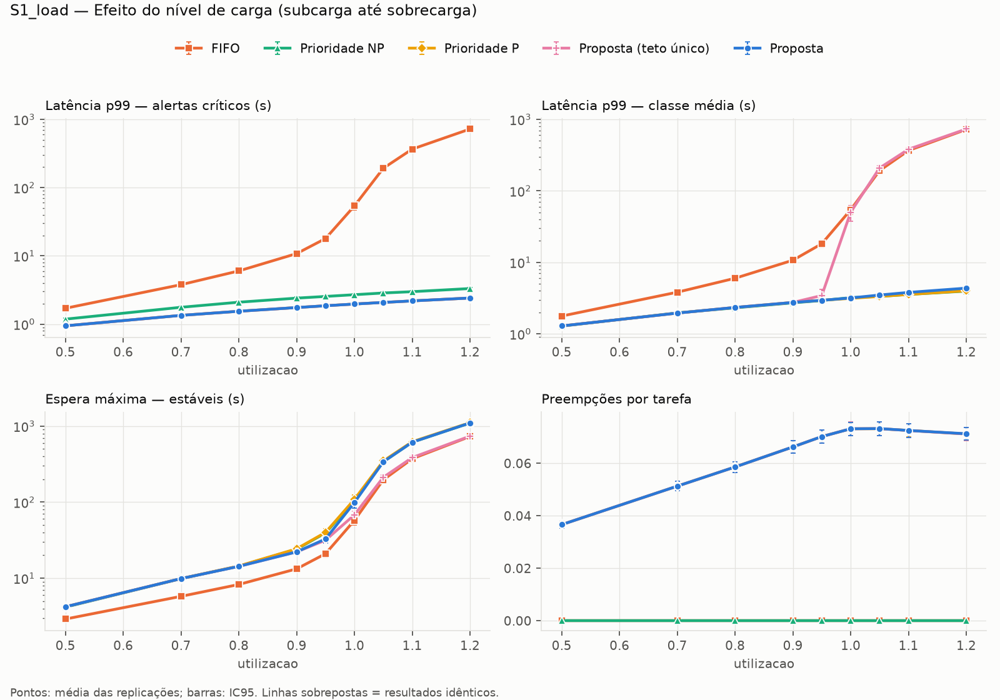
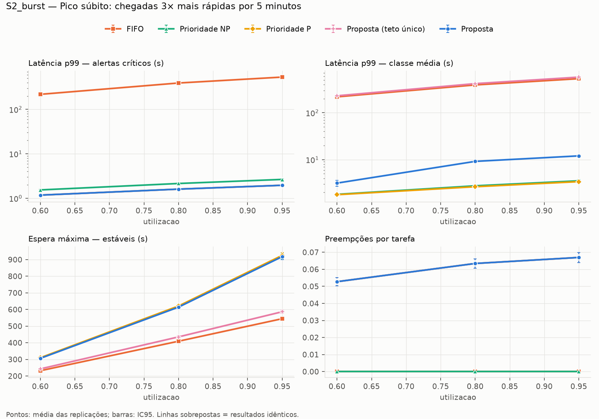
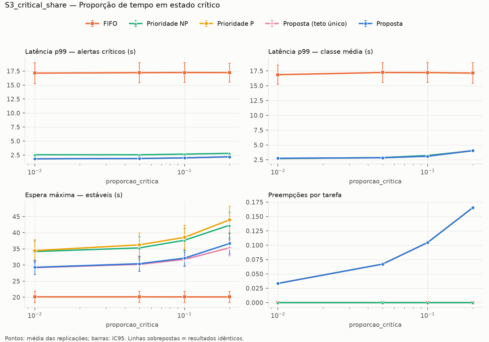
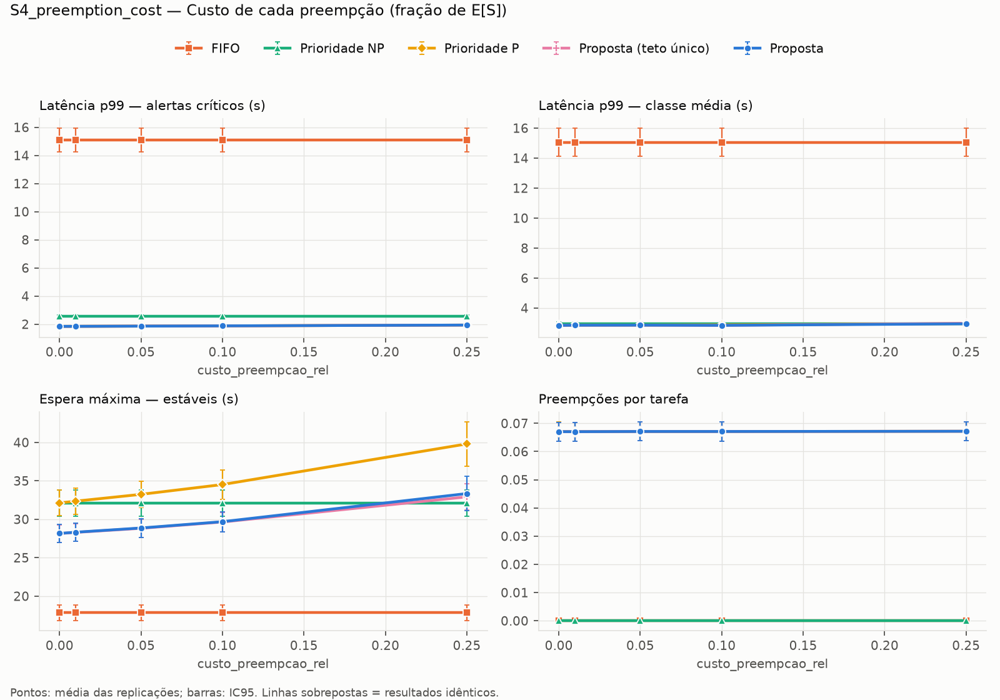
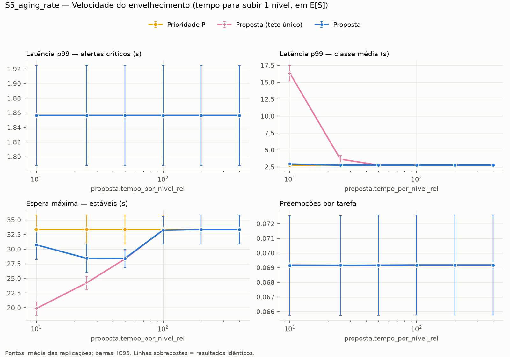
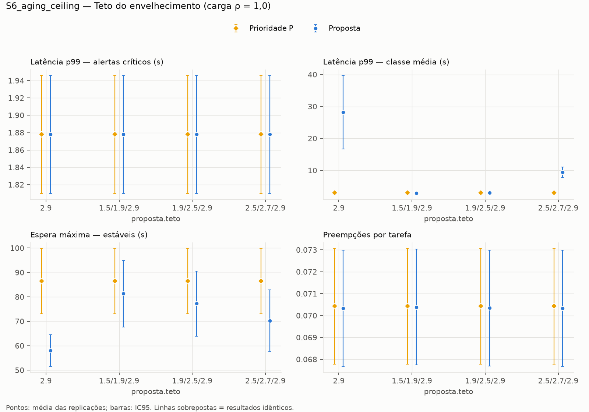
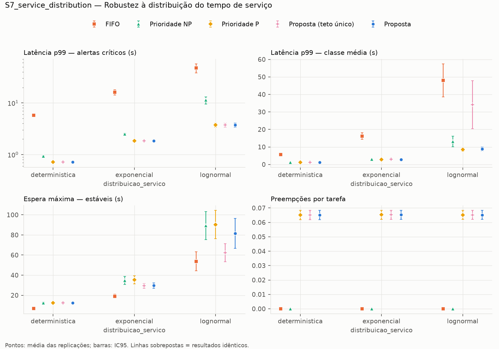

# Relatório dos experimentos

Valores: média ± meia-largura do IC95 sobre as replicações.

## S1_load

Efeito do nível de carga (subcarga até sobrecarga)

**Latência p99 das críticas (s)** (parâmetro: `utilizacao`)

| valor | FIFO | Prioridade NP | Prioridade P | Proposta | Proposta (teto único) |
|---|---|---|---|---|---|
| 0.5 | 1.71 ± 0.061 | 1.18 ± 0.036 | 0.944 ± 0.045 | 0.944 ± 0.045 | 0.944 ± 0.045 |
| 0.7 | 3.78 ± 0.22 | 1.76 ± 0.046 | 1.34 ± 0.067 | 1.34 ± 0.067 | 1.34 ± 0.067 |
| 0.8 | 6.02 ± 0.36 | 2.09 ± 0.066 | 1.54 ± 0.078 | 1.54 ± 0.078 | 1.54 ± 0.078 |
| 0.9 | 10.8 ± 1 | 2.4 ± 0.095 | 1.75 ± 0.09 | 1.75 ± 0.09 | 1.75 ± 0.09 |
| 0.95 | 17.9 ± 2 | 2.55 ± 0.084 | 1.86 ± 0.098 | 1.86 ± 0.098 | 1.86 ± 0.098 |
| 1.0 | 54 ± 7.4 | 2.7 ± 0.095 | 1.97 ± 0.11 | 1.97 ± 0.11 | 1.97 ± 0.11 |
| 1.05 | 192 ± 15 | 2.86 ± 0.086 | 2.08 ± 0.11 | 2.08 ± 0.11 | 2.08 ± 0.11 |
| 1.1 | 367 ± 16 | 2.99 ± 0.085 | 2.19 ± 0.12 | 2.19 ± 0.12 | 2.19 ± 0.12 |
| 1.2 | 722 ± 18 | 3.32 ± 0.12 | 2.41 ± 0.13 | 2.41 ± 0.13 | 2.41 ± 0.13 |

**Latência p99 da classe média (s)** (parâmetro: `utilizacao`)

| valor | FIFO | Prioridade NP | Prioridade P | Proposta | Proposta (teto único) |
|---|---|---|---|---|---|
| 0.5 | 1.77 ± 0.068 | 1.28 ± 0.046 | 1.29 ± 0.043 | 1.29 ± 0.043 | 1.29 ± 0.043 |
| 0.7 | 3.82 ± 0.19 | 1.96 ± 0.087 | 1.95 ± 0.08 | 1.95 ± 0.08 | 1.95 ± 0.08 |
| 0.8 | 5.99 ± 0.33 | 2.31 ± 0.11 | 2.34 ± 0.11 | 2.34 ± 0.11 | 2.34 ± 0.11 |
| 0.9 | 10.7 ± 1 | 2.71 ± 0.11 | 2.75 ± 0.11 | 2.75 ± 0.11 | 2.75 ± 0.11 |
| 0.95 | 18.2 ± 2 | 2.93 ± 0.11 | 2.95 ± 0.14 | 2.94 ± 0.14 | 3.44 ± 0.73 |
| 1.0 | 54.4 ± 7.5 | 3.21 ± 0.15 | 3.13 ± 0.14 | 3.18 ± 0.14 | 50.3 ± 12 |
| 1.05 | 192 ± 15 | 3.34 ± 0.14 | 3.34 ± 0.14 | 3.49 ± 0.16 | 209 ± 15 |
| 1.1 | 366 ± 16 | 3.56 ± 0.14 | 3.56 ± 0.17 | 3.8 ± 0.19 | 381 ± 16 |
| 1.2 | 722 ± 18 | 3.96 ± 0.17 | 4 ± 0.2 | 4.36 ± 0.25 | 732 ± 18 |

**Espera máxima das estáveis (s)** (parâmetro: `utilizacao`)

| valor | FIFO | Prioridade NP | Prioridade P | Proposta | Proposta (teto único) |
|---|---|---|---|---|---|
| 0.5 | 2.9 ± 0.15 | 4.17 ± 0.18 | 4.21 ± 0.19 | 4.21 ± 0.19 | 4.21 ± 0.19 |
| 0.7 | 5.77 ± 0.32 | 9.86 ± 0.83 | 9.89 ± 0.83 | 9.89 ± 0.83 | 9.89 ± 0.83 |
| 0.8 | 8.27 ± 0.48 | 14.4 ± 1.1 | 14.5 ± 1.1 | 14.3 ± 0.97 | 14.3 ± 0.97 |
| 0.9 | 13.3 ± 1.1 | 24.1 ± 2.7 | 24.4 ± 2.7 | 22.2 ± 1.5 | 22.2 ± 1.5 |
| 0.95 | 21 ± 2.1 | 39.4 ± 4.5 | 40 ± 4.5 | 32.8 ± 4 | 31.6 ± 2.5 |
| 1.0 | 57.6 ± 7.4 | 105 ± 15 | 109 ± 15 | 99 ± 15 | 68.1 ± 7.1 |
| 1.05 | 197 ± 15 | 340 ± 27 | 348 ± 27 | 339 ± 27 | 212 ± 15 |
| 1.1 | 372 ± 17 | 614 ± 29 | 623 ± 29 | 614 ± 29 | 386 ± 16 |
| 1.2 | 730 ± 18 | 1.1e+03 ± 30 | 1.11e+03 ± 31 | 1.1e+03 ± 30 | 738 ± 18 |

**Preempções por tarefa** (parâmetro: `utilizacao`)

| valor | FIFO | Prioridade NP | Prioridade P | Proposta | Proposta (teto único) |
|---|---|---|---|---|---|
| 0.5 | 0 ± 0 | 0 ± 0 | 0.0366 ± 0.0014 | 0.0366 ± 0.0014 | 0.0366 ± 0.0014 |
| 0.7 | 0 ± 0 | 0 ± 0 | 0.0513 ± 0.0018 | 0.0513 ± 0.0018 | 0.0513 ± 0.0018 |
| 0.8 | 0 ± 0 | 0 ± 0 | 0.0586 ± 0.002 | 0.0586 ± 0.002 | 0.0586 ± 0.002 |
| 0.9 | 0 ± 0 | 0 ± 0 | 0.0662 ± 0.0023 | 0.0662 ± 0.0023 | 0.0662 ± 0.0023 |
| 0.95 | 0 ± 0 | 0 ± 0 | 0.0702 ± 0.0024 | 0.0702 ± 0.0024 | 0.0702 ± 0.0024 |
| 1.0 | 0 ± 0 | 0 ± 0 | 0.0732 ± 0.0025 | 0.0731 ± 0.0025 | 0.0732 ± 0.0025 |
| 1.05 | 0 ± 0 | 0 ± 0 | 0.0732 ± 0.0026 | 0.0732 ± 0.0026 | 0.0732 ± 0.0026 |
| 1.1 | 0 ± 0 | 0 ± 0 | 0.0725 ± 0.0026 | 0.0725 ± 0.0026 | 0.0725 ± 0.0026 |
| 1.2 | 0 ± 0 | 0 ± 0 | 0.0712 ± 0.0025 | 0.0713 ± 0.0025 | 0.0712 ± 0.0025 |

**Testes (Proposta × outra) — latência p99 das críticas**

| valor | comparada | mediana da diferença (s) | r | p (Holm) |
|---|---|---|---|---|
| 0.5 | FIFO | -0.739 | -1.00 | 2.09e-07 |
| 0.5 | Prioridade NP | -0.241 | -1.00 | 2.09e-07 |
| 0.5 | Prioridade P | 0 | 0.00 | 1 |
| 0.5 | Proposta (teto único) | 0 | 0.00 | 1 |
| 0.7 | FIFO | -2.23 | -1.00 | 2.09e-07 |
| 0.7 | Prioridade NP | -0.408 | -1.00 | 2.09e-07 |
| 0.7 | Prioridade P | 0 | 0.00 | 1 |
| 0.7 | Proposta (teto único) | 0 | 0.00 | 1 |
| 0.8 | FIFO | -4.39 | -1.00 | 2.09e-07 |
| 0.8 | Prioridade NP | -0.551 | -1.00 | 2.09e-07 |
| 0.8 | Prioridade P | 0 | 0.00 | 1 |
| 0.8 | Proposta (teto único) | 0 | 0.00 | 1 |
| 0.9 | FIFO | -8.63 | -1.00 | 2.09e-07 |
| 0.9 | Prioridade NP | -0.632 | -1.00 | 2.09e-07 |
| 0.9 | Prioridade P | 0 | 0.00 | 1 |
| 0.9 | Proposta (teto único) | 0 | 0.00 | 1 |
| 0.95 | FIFO | -14.7 | -1.00 | 2.09e-07 |
| 0.95 | Prioridade NP | -0.636 | -1.00 | 2.09e-07 |
| 0.95 | Prioridade P | 0 | 0.00 | 1 |
| 0.95 | Proposta (teto único) | 0 | 0.00 | 1 |
| 1.0 | FIFO | -52.1 | -1.00 | 2.09e-07 |
| 1.0 | Prioridade NP | -0.706 | -1.00 | 2.09e-07 |
| 1.0 | Prioridade P | 0 | 0.00 | 1 |
| 1.0 | Proposta (teto único) | 0 | 0.00 | 1 |
| 1.05 | FIFO | -187 | -1.00 | 2.09e-07 |
| 1.05 | Prioridade NP | -0.813 | -1.00 | 2.09e-07 |
| 1.05 | Prioridade P | 0 | 0.00 | 1 |
| 1.05 | Proposta (teto único) | 0 | 0.00 | 1 |
| 1.1 | FIFO | -361 | -1.00 | 2.09e-07 |
| 1.1 | Prioridade NP | -0.787 | -1.00 | 2.09e-07 |
| 1.1 | Prioridade P | 0 | 0.00 | 1 |
| 1.1 | Proposta (teto único) | 0 | 0.00 | 1 |
| 1.2 | FIFO | -715 | -1.00 | 2.09e-07 |
| 1.2 | Prioridade NP | -0.907 | -1.00 | 2.09e-07 |
| 1.2 | Prioridade P | 0 | 0.00 | 1 |
| 1.2 | Proposta (teto único) | 0 | 0.00 | 1 |

## S2_burst

Pico súbito: chegadas 3× mais rápidas por 5 minutos

**Latência p99 das críticas (s)** (parâmetro: `utilizacao`)

| valor | FIFO | Prioridade NP | Prioridade P | Proposta | Proposta (teto único) |
|---|---|---|---|---|---|
| 0.6 | 218 ± 5.8 | 1.54 ± 0.047 | 1.18 ± 0.047 | 1.18 ± 0.047 | 1.18 ± 0.047 |
| 0.8 | 392 ± 7.5 | 2.15 ± 0.062 | 1.61 ± 0.063 | 1.61 ± 0.063 | 1.61 ± 0.063 |
| 0.95 | 533 ± 8.5 | 2.66 ± 0.072 | 1.96 ± 0.086 | 1.96 ± 0.086 | 1.96 ± 0.086 |

**Latência p99 da classe média (s)** (parâmetro: `utilizacao`)

| valor | FIFO | Prioridade NP | Prioridade P | Proposta | Proposta (teto único) |
|---|---|---|---|---|---|
| 0.6 | 218 ± 5.8 | 1.82 ± 0.058 | 1.79 ± 0.1 | 3.16 ± 0.47 | 230 ± 5.8 |
| 0.8 | 392 ± 7.5 | 2.77 ± 0.13 | 2.65 ± 0.12 | 9.19 ± 0.52 | 418 ± 8 |
| 0.95 | 532 ± 8.5 | 3.54 ± 0.2 | 3.4 ± 0.2 | 12 ± 0.26 | 575 ± 9.2 |

**Espera máxima das estáveis (s)** (parâmetro: `utilizacao`)

| valor | FIFO | Prioridade NP | Prioridade P | Proposta | Proposta (teto único) |
|---|---|---|---|---|---|
| 0.6 | 232 ± 5.2 | 309 ± 6.5 | 310 ± 6.3 | 306 ± 7.1 | 243 ± 5.1 |
| 0.8 | 409 ± 7 | 618 ± 11 | 621 ± 11 | 614 ± 12 | 435 ± 7.2 |
| 0.95 | 545 ± 8.4 | 921 ± 17 | 925 ± 18 | 918 ± 17 | 586 ± 8.8 |

**Preempções por tarefa** (parâmetro: `utilizacao`)

| valor | FIFO | Prioridade NP | Prioridade P | Proposta | Proposta (teto único) |
|---|---|---|---|---|---|
| 0.6 | 0 ± 0 | 0 ± 0 | 0.0527 ± 0.0025 | 0.0527 ± 0.0025 | 0.0527 ± 0.0025 |
| 0.8 | 0 ± 0 | 0 ± 0 | 0.0634 ± 0.0028 | 0.0634 ± 0.0028 | 0.0634 ± 0.0028 |
| 0.95 | 0 ± 0 | 0 ± 0 | 0.0669 ± 0.0029 | 0.0669 ± 0.0029 | 0.0669 ± 0.0029 |

**Testes (Proposta × outra) — latência p99 das críticas**

| valor | comparada | mediana da diferença (s) | r | p (Holm) |
|---|---|---|---|---|
| 0.6 | FIFO | -214 | -1.00 | 2.09e-07 |
| 0.6 | Prioridade NP | -0.374 | -1.00 | 2.09e-07 |
| 0.6 | Prioridade P | 0 | 0.00 | 1 |
| 0.6 | Proposta (teto único) | 0 | 0.00 | 1 |
| 0.8 | FIFO | -385 | -1.00 | 2.09e-07 |
| 0.8 | Prioridade NP | -0.502 | -1.00 | 2.09e-07 |
| 0.8 | Prioridade P | 0 | 0.00 | 1 |
| 0.8 | Proposta (teto único) | 0 | 0.00 | 1 |
| 0.95 | FIFO | -526 | -1.00 | 2.09e-07 |
| 0.95 | Prioridade NP | -0.695 | -1.00 | 2.09e-07 |
| 0.95 | Prioridade P | 0 | 0.00 | 1 |
| 0.95 | Proposta (teto único) | 0 | 0.00 | 1 |

## S3_critical_share

Proporção de tempo em estado crítico

**Latência p99 das críticas (s)** (parâmetro: `proporcao_critica`)

| valor | FIFO | Prioridade NP | Prioridade P | Proposta | Proposta (teto único) |
|---|---|---|---|---|---|
| 0.01 | 17.1 ± 1.9 | 2.55 ± 0.081 | 1.82 ± 0.067 | 1.82 ± 0.067 | 1.82 ± 0.067 |
| 0.05 | 17.2 ± 1.8 | 2.55 ± 0.065 | 1.87 ± 0.06 | 1.87 ± 0.06 | 1.87 ± 0.06 |
| 0.1 | 17.2 ± 1.8 | 2.66 ± 0.068 | 1.99 ± 0.06 | 1.99 ± 0.06 | 1.99 ± 0.06 |
| 0.2 | 17.2 ± 1.7 | 2.8 ± 0.058 | 2.18 ± 0.05 | 2.18 ± 0.05 | 2.18 ± 0.05 |

**Latência p99 da classe média (s)** (parâmetro: `proporcao_critica`)

| valor | FIFO | Prioridade NP | Prioridade P | Proposta | Proposta (teto único) |
|---|---|---|---|---|---|
| 0.01 | 16.9 ± 1.6 | 2.69 ± 0.096 | 2.73 ± 0.085 | 2.75 ± 0.089 | 2.75 ± 0.089 |
| 0.05 | 17.2 ± 1.7 | 2.87 ± 0.11 | 2.84 ± 0.084 | 2.84 ± 0.087 | 2.84 ± 0.087 |
| 0.1 | 17.2 ± 1.7 | 3.23 ± 0.14 | 3.1 ± 0.1 | 3.09 ± 0.11 | 3.1 ± 0.11 |
| 0.2 | 17.1 ± 1.8 | 4.02 ± 0.26 | 4.02 ± 0.19 | 4.03 ± 0.2 | 4.06 ± 0.19 |

**Espera máxima das estáveis (s)** (parâmetro: `proporcao_critica`)

| valor | FIFO | Prioridade NP | Prioridade P | Proposta | Proposta (teto único) |
|---|---|---|---|---|---|
| 0.01 | 20.1 ± 1.8 | 34.2 ± 3.3 | 34.4 ± 3.4 | 29.3 ± 2.2 | 29.2 ± 2.2 |
| 0.05 | 20.1 ± 1.8 | 35.3 ± 3.4 | 36.2 ± 3.7 | 30.4 ± 2.3 | 30.2 ± 2.2 |
| 0.1 | 20.1 ± 1.8 | 37.7 ± 3.7 | 38.6 ± 3.8 | 32.1 ± 2.4 | 31.7 ± 2.2 |
| 0.2 | 20.1 ± 1.7 | 42.3 ± 4 | 44 ± 4.3 | 36.7 ± 3.2 | 35.3 ± 2.5 |

**Preempções por tarefa** (parâmetro: `proporcao_critica`)

| valor | FIFO | Prioridade NP | Prioridade P | Proposta | Proposta (teto único) |
|---|---|---|---|---|---|
| 0.01 | 0 ± 0 | 0 ± 0 | 0.0334 ± 0.0017 | 0.0334 ± 0.0017 | 0.0334 ± 0.0017 |
| 0.05 | 0 ± 0 | 0 ± 0 | 0.0671 ± 0.0026 | 0.0671 ± 0.0026 | 0.0671 ± 0.0026 |
| 0.1 | 0 ± 0 | 0 ± 0 | 0.105 ± 0.0032 | 0.105 ± 0.0032 | 0.105 ± 0.0032 |
| 0.2 | 0 ± 0 | 0 ± 0 | 0.165 ± 0.003 | 0.165 ± 0.003 | 0.165 ± 0.003 |

**Testes (Proposta × outra) — latência p99 das críticas**

| valor | comparada | mediana da diferença (s) | r | p (Holm) |
|---|---|---|---|---|
| 0.01 | FIFO | -14.2 | -1.00 | 2.09e-07 |
| 0.01 | Prioridade NP | -0.663 | -1.00 | 2.09e-07 |
| 0.01 | Prioridade P | 0 | 0.00 | 1 |
| 0.01 | Proposta (teto único) | 0 | 0.00 | 1 |
| 0.05 | FIFO | -15 | -1.00 | 2.09e-07 |
| 0.05 | Prioridade NP | -0.691 | -1.00 | 2.09e-07 |
| 0.05 | Prioridade P | 0 | 0.00 | 1 |
| 0.05 | Proposta (teto único) | 0 | 0.00 | 1 |
| 0.1 | FIFO | -15.2 | -1.00 | 2.09e-07 |
| 0.1 | Prioridade NP | -0.665 | -1.00 | 2.09e-07 |
| 0.1 | Prioridade P | 0 | 0.00 | 1 |
| 0.1 | Proposta (teto único) | 0 | 0.00 | 1 |
| 0.2 | FIFO | -15.3 | -1.00 | 2.09e-07 |
| 0.2 | Prioridade NP | -0.604 | -1.00 | 2.09e-07 |
| 0.2 | Prioridade P | 0 | 0.00 | 1 |
| 0.2 | Proposta (teto único) | 0 | 0.00 | 1 |

## S4_preemption_cost

Custo de cada preempção (fração de E[S])

**Latência p99 das críticas (s)** (parâmetro: `custo_preempcao_rel`)

| valor | FIFO | Prioridade NP | Prioridade P | Proposta | Proposta (teto único) |
|---|---|---|---|---|---|
| 0.0 | 15.1 ± 0.84 | 2.57 ± 0.078 | 1.84 ± 0.062 | 1.84 ± 0.062 | 1.84 ± 0.062 |
| 0.01 | 15.1 ± 0.84 | 2.57 ± 0.078 | 1.85 ± 0.062 | 1.85 ± 0.062 | 1.85 ± 0.062 |
| 0.05 | 15.1 ± 0.84 | 2.57 ± 0.078 | 1.86 ± 0.062 | 1.86 ± 0.062 | 1.86 ± 0.062 |
| 0.1 | 15.1 ± 0.84 | 2.57 ± 0.078 | 1.88 ± 0.062 | 1.88 ± 0.062 | 1.88 ± 0.062 |
| 0.25 | 15.1 ± 0.84 | 2.57 ± 0.078 | 1.94 ± 0.062 | 1.94 ± 0.062 | 1.94 ± 0.062 |

**Latência p99 da classe média (s)** (parâmetro: `custo_preempcao_rel`)

| valor | FIFO | Prioridade NP | Prioridade P | Proposta | Proposta (teto único) |
|---|---|---|---|---|---|
| 0.0 | 15 ± 0.94 | 2.94 ± 0.13 | 2.84 ± 0.12 | 2.85 ± 0.12 | 2.85 ± 0.12 |
| 0.01 | 15 ± 0.94 | 2.94 ± 0.13 | 2.87 ± 0.12 | 2.85 ± 0.11 | 2.85 ± 0.11 |
| 0.05 | 15 ± 0.94 | 2.94 ± 0.13 | 2.86 ± 0.12 | 2.86 ± 0.11 | 2.86 ± 0.11 |
| 0.1 | 15 ± 0.94 | 2.94 ± 0.13 | 2.88 ± 0.12 | 2.85 ± 0.12 | 2.85 ± 0.12 |
| 0.25 | 15 ± 0.94 | 2.94 ± 0.13 | 2.96 ± 0.12 | 2.95 ± 0.11 | 2.98 ± 0.14 |

**Espera máxima das estáveis (s)** (parâmetro: `custo_preempcao_rel`)

| valor | FIFO | Prioridade NP | Prioridade P | Proposta | Proposta (teto único) |
|---|---|---|---|---|---|
| 0.0 | 17.8 ± 1 | 32.1 ± 1.7 | 32.1 ± 1.7 | 28.2 ± 1.2 | 28.1 ± 1.1 |
| 0.01 | 17.8 ± 1 | 32.1 ± 1.7 | 32.4 ± 1.7 | 28.3 ± 1.2 | 28.3 ± 1.2 |
| 0.05 | 17.8 ± 1 | 32.1 ± 1.7 | 33.2 ± 1.7 | 28.9 ± 1.2 | 28.8 ± 1.2 |
| 0.1 | 17.8 ± 1 | 32.1 ± 1.7 | 34.5 ± 1.9 | 29.7 ± 1.3 | 29.6 ± 1.3 |
| 0.25 | 17.8 ± 1 | 32.1 ± 1.7 | 39.8 ± 2.9 | 33.3 ± 2.3 | 32.9 ± 1.7 |

**Preempções por tarefa** (parâmetro: `custo_preempcao_rel`)

| valor | FIFO | Prioridade NP | Prioridade P | Proposta | Proposta (teto único) |
|---|---|---|---|---|---|
| 0.0 | 0 ± 0 | 0 ± 0 | 0.0671 ± 0.0033 | 0.067 ± 0.0033 | 0.067 ± 0.0033 |
| 0.01 | 0 ± 0 | 0 ± 0 | 0.067 ± 0.0033 | 0.067 ± 0.0033 | 0.067 ± 0.0033 |
| 0.05 | 0 ± 0 | 0 ± 0 | 0.0671 ± 0.0033 | 0.0671 ± 0.0033 | 0.0671 ± 0.0033 |
| 0.1 | 0 ± 0 | 0 ± 0 | 0.0671 ± 0.0034 | 0.0671 ± 0.0034 | 0.0671 ± 0.0034 |
| 0.25 | 0 ± 0 | 0 ± 0 | 0.0672 ± 0.0034 | 0.0672 ± 0.0034 | 0.0672 ± 0.0034 |

**Testes (Proposta × outra) — latência p99 das críticas**

| valor | comparada | mediana da diferença (s) | r | p (Holm) |
|---|---|---|---|---|
| 0.0 | FIFO | -12.8 | -1.00 | 2.09e-07 |
| 0.0 | Prioridade NP | -0.668 | -1.00 | 2.09e-07 |
| 0.0 | Prioridade P | 0 | 0.00 | 1 |
| 0.0 | Proposta (teto único) | 0 | 0.00 | 1 |
| 0.01 | FIFO | -12.8 | -1.00 | 2.09e-07 |
| 0.01 | Prioridade NP | -0.664 | -1.00 | 2.09e-07 |
| 0.01 | Prioridade P | 0 | 0.00 | 1 |
| 0.01 | Proposta (teto único) | 0 | 0.00 | 1 |
| 0.05 | FIFO | -12.8 | -1.00 | 2.09e-07 |
| 0.05 | Prioridade NP | -0.649 | -1.00 | 2.09e-07 |
| 0.05 | Prioridade P | 0 | 0.00 | 1 |
| 0.05 | Proposta (teto único) | 0 | 0.00 | 1 |
| 0.1 | FIFO | -12.8 | -1.00 | 2.09e-07 |
| 0.1 | Prioridade NP | -0.63 | -1.00 | 2.09e-07 |
| 0.1 | Prioridade P | 0 | 0.00 | 1 |
| 0.1 | Proposta (teto único) | 0 | 0.00 | 1 |
| 0.25 | FIFO | -12.7 | -1.00 | 2.09e-07 |
| 0.25 | Prioridade NP | -0.573 | -1.00 | 2.09e-07 |
| 0.25 | Prioridade P | 0 | 0.00 | 1 |
| 0.25 | Proposta (teto único) | 0 | 0.00 | 1 |

## S5_aging_rate

Velocidade do envelhecimento (tempo para subir 1 nível, em E[S])

**Latência p99 das críticas (s)** (parâmetro: `proposta.tempo_por_nivel_rel`)

| valor | Prioridade P | Proposta | Proposta (teto único) |
|---|---|---|---|
| 10 | 1.86 ± 0.069 | 1.86 ± 0.069 | 1.86 ± 0.069 |
| 25 | 1.86 ± 0.069 | 1.86 ± 0.069 | 1.86 ± 0.069 |
| 50 | 1.86 ± 0.069 | 1.86 ± 0.069 | 1.86 ± 0.069 |
| 100 | 1.86 ± 0.069 | 1.86 ± 0.069 | 1.86 ± 0.069 |
| 200 | 1.86 ± 0.069 | 1.86 ± 0.069 | 1.86 ± 0.069 |
| 400 | 1.86 ± 0.069 | 1.86 ± 0.069 | 1.86 ± 0.069 |

**Latência p99 da classe média (s)** (parâmetro: `proposta.tempo_por_nivel_rel`)

| valor | Prioridade P | Proposta | Proposta (teto único) |
|---|---|---|---|
| 10 | 2.76 ± 0.077 | 2.93 ± 0.15 | 16.3 ± 1.2 |
| 25 | 2.76 ± 0.077 | 2.76 ± 0.077 | 3.66 ± 0.55 |
| 50 | 2.76 ± 0.077 | 2.76 ± 0.078 | 2.76 ± 0.078 |
| 100 | 2.76 ± 0.077 | 2.76 ± 0.077 | 2.76 ± 0.077 |
| 200 | 2.76 ± 0.077 | 2.76 ± 0.077 | 2.76 ± 0.077 |
| 400 | 2.76 ± 0.077 | 2.76 ± 0.077 | 2.76 ± 0.077 |

**Espera máxima das estáveis (s)** (parâmetro: `proposta.tempo_por_nivel_rel`)

| valor | Prioridade P | Proposta | Proposta (teto único) |
|---|---|---|---|
| 10 | 33.3 ± 2.5 | 30.7 ± 2.5 | 19.9 ± 1.2 |
| 25 | 33.3 ± 2.5 | 28.4 ± 2.4 | 24.3 ± 1.1 |
| 50 | 33.3 ± 2.5 | 28.4 ± 1.6 | 28.3 ± 1.5 |
| 100 | 33.3 ± 2.5 | 33.2 ± 2.4 | 33.2 ± 2.4 |
| 200 | 33.3 ± 2.5 | 33.3 ± 2.5 | 33.3 ± 2.5 |
| 400 | 33.3 ± 2.5 | 33.3 ± 2.5 | 33.3 ± 2.5 |

**Preempções por tarefa** (parâmetro: `proposta.tempo_por_nivel_rel`)

| valor | Prioridade P | Proposta | Proposta (teto único) |
|---|---|---|---|
| 10 | 0.0692 ± 0.0034 | 0.0692 ± 0.0034 | 0.0692 ± 0.0034 |
| 25 | 0.0692 ± 0.0034 | 0.0692 ± 0.0034 | 0.0692 ± 0.0034 |
| 50 | 0.0692 ± 0.0034 | 0.0692 ± 0.0034 | 0.0692 ± 0.0034 |
| 100 | 0.0692 ± 0.0034 | 0.0692 ± 0.0034 | 0.0692 ± 0.0034 |
| 200 | 0.0692 ± 0.0034 | 0.0692 ± 0.0034 | 0.0692 ± 0.0034 |
| 400 | 0.0692 ± 0.0034 | 0.0692 ± 0.0034 | 0.0692 ± 0.0034 |

**Testes (Proposta × outra) — latência p99 das críticas**

| valor | comparada | mediana da diferença (s) | r | p (Holm) |
|---|---|---|---|---|
| 10 | Prioridade P | 0 | 0.00 | 1 |
| 10 | Proposta (teto único) | 0 | 0.00 | 1 |
| 100 | Prioridade P | 0 | 0.00 | 1 |
| 100 | Proposta (teto único) | 0 | 0.00 | 1 |
| 200 | Prioridade P | 0 | 0.00 | 1 |
| 200 | Proposta (teto único) | 0 | 0.00 | 1 |
| 25 | Prioridade P | 0 | 0.00 | 1 |
| 25 | Proposta (teto único) | 0 | 0.00 | 1 |
| 400 | Prioridade P | 0 | 0.00 | 1 |
| 400 | Proposta (teto único) | 0 | 0.00 | 1 |
| 50 | Prioridade P | 0 | 0.00 | 1 |
| 50 | Proposta (teto único) | 0 | 0.00 | 1 |

## S6_aging_ceiling

Teto do envelhecimento (carga ρ = 1,0)

**Latência p99 das críticas (s)** (parâmetro: `proposta.teto`)

| valor | Prioridade P | Proposta |
|---|---|---|
| 2.9 | 1.88 ± 0.068 | 1.88 ± 0.068 |
| 1.5/1.9/2.9 | 1.88 ± 0.068 | 1.88 ± 0.068 |
| 1.9/2.5/2.9 | 1.88 ± 0.068 | 1.88 ± 0.068 |
| 2.5/2.7/2.9 | 1.88 ± 0.068 | 1.88 ± 0.068 |

**Latência p99 da classe média (s)** (parâmetro: `proposta.teto`)

| valor | Prioridade P | Proposta |
|---|---|---|
| 2.9 | 2.98 ± 0.12 | 28.2 ± 12 |
| 1.5/1.9/2.9 | 2.98 ± 0.12 | 2.94 ± 0.11 |
| 1.9/2.5/2.9 | 2.98 ± 0.12 | 2.98 ± 0.11 |
| 2.5/2.7/2.9 | 2.98 ± 0.12 | 9.43 ± 1.7 |

**Espera máxima das estáveis (s)** (parâmetro: `proposta.teto`)

| valor | Prioridade P | Proposta |
|---|---|---|
| 2.9 | 86.6 ± 13 | 58.1 ± 6.5 |
| 1.5/1.9/2.9 | 86.6 ± 13 | 81.3 ± 14 |
| 1.9/2.5/2.9 | 86.6 ± 13 | 77.3 ± 13 |
| 2.5/2.7/2.9 | 86.6 ± 13 | 70.3 ± 13 |

**Preempções por tarefa** (parâmetro: `proposta.teto`)

| valor | Prioridade P | Proposta |
|---|---|---|
| 2.9 | 0.0704 ± 0.0026 | 0.0703 ± 0.0027 |
| 1.5/1.9/2.9 | 0.0704 ± 0.0026 | 0.0704 ± 0.0026 |
| 1.9/2.5/2.9 | 0.0704 ± 0.0026 | 0.0703 ± 0.0027 |
| 2.5/2.7/2.9 | 0.0704 ± 0.0026 | 0.0703 ± 0.0027 |

**Testes (Proposta × outra) — latência p99 das críticas**

| valor | comparada | mediana da diferença (s) | r | p (Holm) |
|---|---|---|---|---|
| 2.9 | Prioridade P | 0 | 0.00 | 1 |
| 1.5/1.9/2.9 | Prioridade P | 0 | 0.00 | 1 |
| 1.9/2.5/2.9 | Prioridade P | 0 | 0.00 | 1 |
| 2.5/2.7/2.9 | Prioridade P | 0 | 0.00 | 1 |

## S7_service_distribution

Robustez à distribuição do tempo de serviço

**Latência p99 das críticas (s)** (parâmetro: `distribuicao_servico`)

| valor | FIFO | Prioridade NP | Prioridade P | Proposta | Proposta (teto único) |
|---|---|---|---|---|---|
| deterministica | 5.79 ± 0.36 | 0.931 ± 0.02 | 0.714 ± 0.01 | 0.714 ± 0.01 | 0.714 ± 0.01 |
| exponencial | 16.2 ± 1.9 | 2.52 ± 0.066 | 1.85 ± 0.061 | 1.85 ± 0.061 | 1.85 ± 0.061 |
| lognormal | 47.5 ± 9.5 | 11.3 ± 1.8 | 3.74 ± 0.36 | 3.74 ± 0.36 | 3.74 ± 0.36 |

**Latência p99 da classe média (s)** (parâmetro: `distribuicao_servico`)

| valor | FIFO | Prioridade NP | Prioridade P | Proposta | Proposta (teto único) |
|---|---|---|---|---|---|
| deterministica | 5.72 ± 0.36 | 1.19 ± 0.051 | 1.23 ± 0.048 | 1.23 ± 0.048 | 1.23 ± 0.048 |
| exponencial | 16.2 ± 1.9 | 2.94 ± 0.12 | 2.86 ± 0.097 | 2.87 ± 0.1 | 2.89 ± 0.11 |
| lognormal | 48 ± 9.4 | 13.1 ± 3 | 8.44 ± 1 | 8.82 ± 1.1 | 34.1 ± 14 |

**Espera máxima das estáveis (s)** (parâmetro: `distribuicao_servico`)

| valor | FIFO | Prioridade NP | Prioridade P | Proposta | Proposta (teto único) |
|---|---|---|---|---|---|
| deterministica | 6.95 ± 0.4 | 12.3 ± 0.73 | 12.5 ± 0.73 | 12.5 ± 0.73 | 12.5 ± 0.73 |
| exponencial | 19 ± 2 | 34.7 ± 3.9 | 35.3 ± 4 | 29.7 ± 2.6 | 29.4 ± 2.3 |
| lognormal | 53.7 ± 9.5 | 89.3 ± 14 | 90.3 ± 14 | 81.5 ± 15 | 62.3 ± 8.9 |

**Preempções por tarefa** (parâmetro: `distribuicao_servico`)

| valor | FIFO | Prioridade NP | Prioridade P | Proposta | Proposta (teto único) |
|---|---|---|---|---|---|
| deterministica | 0 ± 0 | 0 ± 0 | 0.0651 ± 0.0032 | 0.0651 ± 0.0032 | 0.0651 ± 0.0032 |
| exponencial | 0 ± 0 | 0 ± 0 | 0.0652 ± 0.0032 | 0.0652 ± 0.0032 | 0.0652 ± 0.0032 |
| lognormal | 0 ± 0 | 0 ± 0 | 0.0652 ± 0.0031 | 0.0651 ± 0.0032 | 0.0651 ± 0.0032 |

**Testes (Proposta × outra) — latência p99 das críticas**

| valor | comparada | mediana da diferença (s) | r | p (Holm) |
|---|---|---|---|---|
| deterministica | FIFO | -4.8 | -1.00 | 2.09e-07 |
| deterministica | Prioridade NP | -0.222 | -1.00 | 2.09e-07 |
| deterministica | Prioridade P | 0 | 0.00 | 1 |
| deterministica | Proposta (teto único) | 0 | 0.00 | 1 |
| exponencial | FIFO | -12.3 | -1.00 | 2.09e-07 |
| exponencial | Prioridade NP | -0.643 | -1.00 | 2.09e-07 |
| exponencial | Prioridade P | 0 | 0.00 | 1 |
| exponencial | Proposta (teto único) | 0 | 0.00 | 1 |
| lognormal | FIFO | -35.9 | -1.00 | 2.09e-07 |
| lognormal | Prioridade NP | -6.99 | -1.00 | 2.09e-07 |
| lognormal | Prioridade P | 0 | 0.00 | 1 |
| lognormal | Proposta (teto único) | 0 | 0.00 | 1 |

